🇬🇧 English | 🇫🇷 [Français](README_FR.md) | 🇪🇸 [Español](README_ES.md)

# ArcadeMatrix RPi 🍓👾

[](https://t.me/+DrSdAO8UMUViNmE0)
[](https://ko-fi.com/red1l)

💬 **Telegram Community:** [https://t.me/+DrSdAO8UMUViNmE0](https://t.me/+DrSdAO8UMUViNmE0)  
📺 **Video Demo / Présentation :** https://youtu.be/vAK880Io8yo?si=KSieTymlE7fLyZQs

The original **Rust** implementation of the **ArcadeMatrix** project, specifically designed to run on a **Raspberry Pi** connected to an RGB LED Matrix (HUB75) via the Adafruit HAT or Joy-IT hardware.

Developed in parallel with the ESP32 C++ version, this implementation leverages the power of the Raspberry Pi to deliver a high-performance multi-threaded graphics pipeline.

📚 **Developer docs:** [Getting Started (dev workspace)](docs/GETTING_STARTED.md) · [Developer Guide](docs/DEVELOPER.md) · [Architecture](docs/ARCHITECTURE.md) · [Quickstart (end users)](docs/QUICKSTART.md) · [PC/manual tools](tools/README.md)

---

## 💾 Quickstart: Pre-compiled Image (Recommended)

We provide pre-compiled, fully automated `.img` files, built and published automatically on every release.

| Architecture | Recommended For | Compatible With | Download |
|--------------|-----------------|-----------------|----------|
| **64-bit (aarch64)** | Raspberry Pi 3, 4, 5, Zero 2 W | Pi 3, 4, 5, Zero 2 W | [⬇️ Download 64-bit Image](https://github.com/red77290/ArcadeMatrix_RPI/releases/latest/download/ArcadeMatrix_Release_aarch64.img.xz) |
| **32-bit (armhf)** | Raspberry Pi 1, 2, Zero (Original) | All Raspberry Pi models | [⬇️ Download 32-bit Image](https://github.com/red77290/ArcadeMatrix_RPI/releases/latest/download/ArcadeMatrix_Release_armhf.img.xz) |

*(Both are `.img.xz` files - decompress with 7-Zip/Keka/`xz -d` before flashing. See the [full release list](https://github.com/red77290/ArcadeMatrix_RPI/releases) for older versions.)*

1. Flash the `.img` to your SD card using **Raspberry Pi Imager**.
2. Once flashed, insert the SD card into your PC/Mac. You will see a large **DATA** USB drive appear!
3. Open the `config.json` file located on this DATA drive to configure your Matrix size and your **Wi-Fi** credentials (`"ssid"` and `"password"`).
4. Plug the SD card into your Raspberry Pi and power it on.
5. The Matrix will immediately turn on and **display the IP address** for 5 seconds. Use this IP to access the Web UI!

---

## 🕹️ Built-in Engines & Hardware Simulations

Every engine in ArcadeMatrix RPi is engineered in pure, multi-threaded Rust with **zero allocation on the display render cycle**, guaranteeing a rock-solid 60 FPS refresh rate. Below are hardware-accurate simulations of each engine running on physical HUB75 displays:

| Engine / ID | Hardware Simulation | Description & Key Features |
| :--- | :---: | :--- |
| **Desk Master Dashboard**<br>`dashboard` | 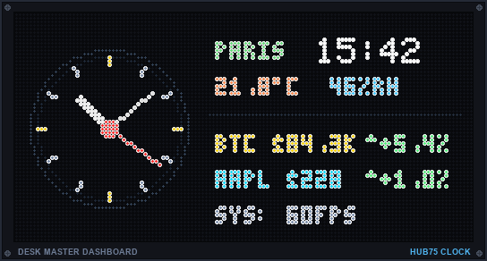 | Complete horizontal desk deck with handcrafted analog watch dial, smooth sweeping second hand, world clocks, live OpenWeatherMap weather, and live Binance cryptos & Yahoo Finance stocks ticker. |
| **Retro Game Clock**<br>`clock` | 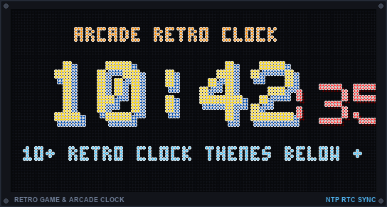<br><br>[👉 **View 10+ Retro Clocks Showcase ➔**](#-signature-themed-clocks-collection) | Signature animated retro arcade and console clocks (Metal Slug, Castlevania, Mario, Mega Man, Sonic, Pokédex, Pac-Man, Tetris, World Clock, Matrix Rain...) with 100% bit-perfect sprites. |
| **M.U.G.E.N Arcade Fighters**<br>`fighter` *(Transverse Overlay)* | 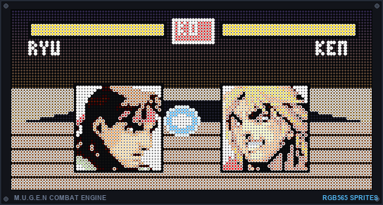 | Transverse overlay renderer (`system.idle_fighter_enabled`, not a standalone rotation engine ID) bringing authentic retro fighting game sprites (Street Fighter, King of Fighters, etc.) with real-time healthbars, custom stages, and autonomous CPU battles over clocks and dates. |
| **Spotify Now Playing**<br>`spotify` | 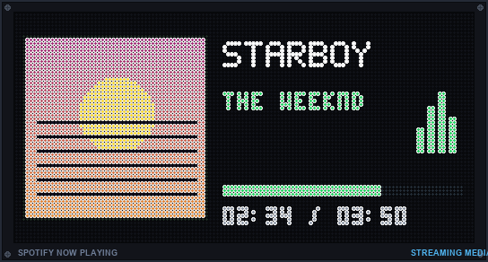 | Real-time track display with full-color album artwork, scrolling artist/title, animated mini equalizer bars, and track progress. |
| **Google Cast & Nest**<br>`google_cast` | 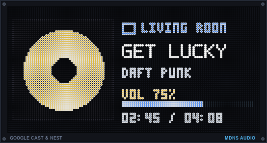 | Automatic mDNS discovery of Google Home / Nest Audio devices with live streaming media artwork, volume, and playback progress. |
| **Crypto Ticker & Chart**<br>`crypto` | 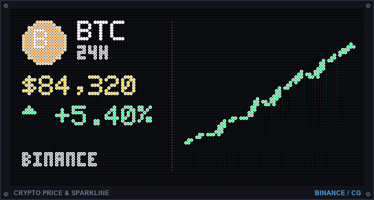 | Live Binance / CoinGecko prices, 24h change badge, and real-time historical sparkline charts with smart TTL caching. |
| **Stock Market Ticker**<br>`stock` | 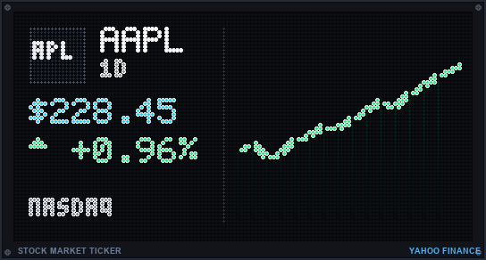 | Real-time quotes from Yahoo Finance, 1D % badges, and intraday sparkline area charts for NASDAQ/S&P stocks and ETFs. |
| **Weather Forecast**<br>`weather` | 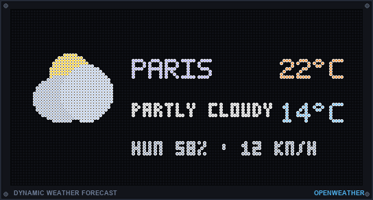 | Live outdoor conditions, high/low temperatures, humidity, wind, and animated retro icons via OpenWeatherMap & Open-Meteo. |
| **System Telemetry HUD**<br>`system_info` | 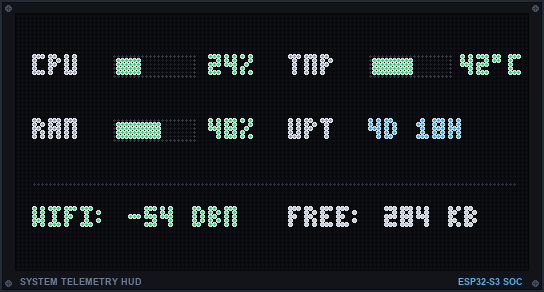 | Real-time dual-column monitor of Raspberry Pi CPU usage (%), RAM (%), SoC hardware temperature (°C/°F), and system Uptime with vibrant gauge bars. |
| **Live News Ticker**<br>`gnews` | 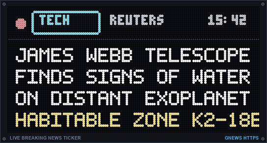 | Real-time breaking headlines with topic pills (`[TECH]`, `[WORLD]`, `[BIZ]`), live pulsing red beacon, and smooth sub-pixel scrolling ticker. |
| **Home Assistant & MQTT**<br>`mqttdata` | 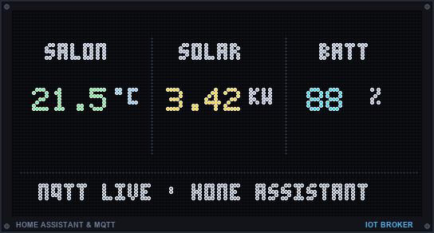 | Stream Home Assistant dashboards, sensor values, 24h historical charts, and local weather via MQTT with ready-to-use blueprints. |
| **Animated GIF Player**<br>`gifs` | 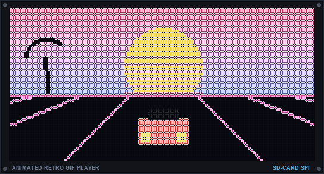 | Smooth 60 FPS playback of retro animations, folders, and network playlists with zero-copy row span presentation. |
| **Scrolling Text Banner**<br>`message` | 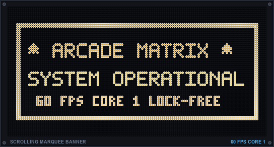 | Customizable dot-matrix marquee signs with glowing amber typography, multiple scroll directions, and REST API triggers. |
| **Arcade Cabinet Marquee**<br>`marquee` | 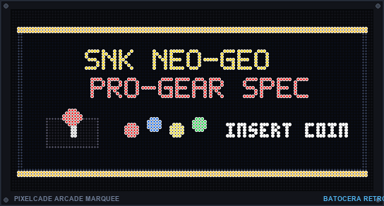 | Displays official illuminated arcade marquees via Pixelcade integration for Batocera, Recalbox, and RetroPie gaming setups. |
| **Calendar & Date**<br>`date` | 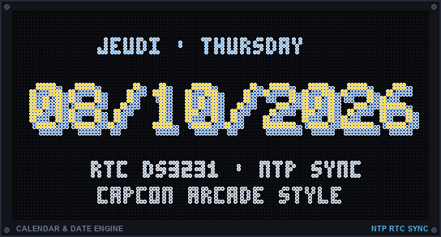 | Large arcade-styled date with 3D Capcom/Nintendo drop shadows, multi-language support (EN, FR, ES), and NTP synchronization. |

> [!NOTE]
> **Hardware Rendering Notice:** The engine preview displays and clock showcase posters shown in this documentation are high-fidelity software simulations designed to illustrate visual layouts, animations, and telemetry widgets. Actual hardware rendering on a physical HUB75 LED matrix panel may differ depending on LED pitch, optical acrylic diffusion, viewing distance, and ambient brightness.

### 🌟 Core Architecture Highlights (RPi Exclusives & ESP32 Alignment)

* 🎯 **Canonical Display Arbiter & Preemption Engine**: Bounded $O(1)$ zero-allocation decision pipeline with multi-source priority arbitration (`Rotation` 10 $\to$ `GIF` 20 $\to$ `Marquee` 30 $\to$ `MQTT` 40), `PreemptionStack<4>`, exact intent matching, and resilient orphan cleanup.
* 🧭 **Dynamic Orientation & Tate Mode (`OrientationManager`)**: Multi-angle manual and responsive rotation (0°, 90°, 180°, 270°) with automatic layout classification (`LayoutClass`) and reactive versioning.
* 🔄 **Over-The-Air (OTA) Firmware Update**: Update the single standalone Rust binary directly from the Web UI without re-flashing your SD Card image! *(Failsafe Recovery: If an OTA update ever breaks your system, plug your SD card into a PC and drop a valid firmware named `arcadematrix_recovery.bin` at the root of either the `bootfs` partition or the `DATA` partition. It will automatically install on the next boot!)*
* 🚀 **Rust Native Multi-Threaded Engine**: High-performance multi-threaded engine using Actix-web and image processing in pure compiled Rust with 0% idle CPU overhead.
* ⚡ **Zero-Copy DirtyBounds Canvas Pipeline (`canvas_single`)**: Single off-screen canvas with zero-copy row span presentation and `DirtyBounds` dirty line tracking. On static clock frames and slow-moving animations, `present()` immediately detects clean state and never touches the Broadcom memory bus or DMA engine, completely eliminating SDIO Wi-Fi drops!
* 🗂️ **Network GIF Library & Web File Manager (`/api/gifs/*`)**: Complete network management of GIF playlists directly from the Web UI! Browse playlist folders, upload animated GIFs over Wi-Fi/Ethernet, create/delete folders, rename items, and trigger automatic background library re-indexing. Native dual-orientation support (`?orientation=yoko|tate`) for both Horizontal (Yoko) and Vertical (Tate) display layouts — implemented by [@TooncesToo](https://github.com/TooncesToo)!
* 🔤 **Dynamically Loadable Fonts (`.ttf`)**: Drop any `.ttf` or `.otf` font directly into the `fonts/` folder, and the Web UI will automatically list it for use on the Clock or Date.
* 🌧️ **True Matrix Digital Rain (Katakana)**: A completely custom, buttery smooth, genuine Matrix digital rain effect (`DotGothic16`) with falling half-width Katakana and "unlit LED" negative space text punching through the rain.

---

## 🎨 Signature Themed Clocks Collection

ArcadeMatrix RPi includes a signature collection of handcrafted, hardware-synchronized retro arcade and console clocks rendered with 100% bit-perfect original sprites in full 60 FPS, with full multi-resolution support for Landscape (64x64, 128x32, 256x64) and Portrait / Tate modes (32x64, 64x128, 64x256):

### 1. Metal Slug: Super Vehicle-001 (SNK Neo Geo) — Theme 41
*Authentic SNK Neo Geo pixel art with Arabian desert bazaar backdrop, Marco Rossi combat animations, Rebel Di-Cokka tank, patrol helicopter, and heavy machine gun firefights.*
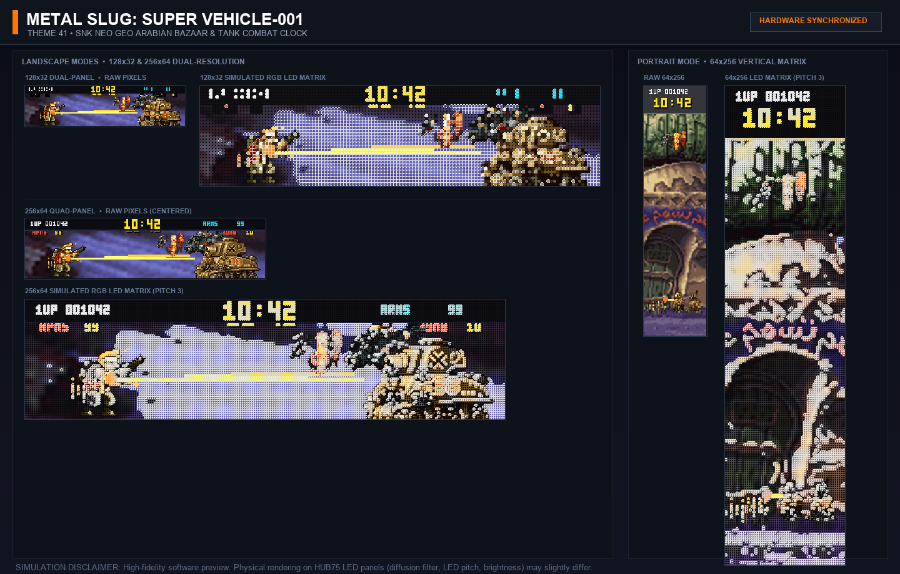

### 2. Castlevania (Konami NES) — Theme 31
*Gothic clock tower Belfry with Simon Belmont climbing the grand stone staircase toward Dracula's chamber, authentic pedestal torch, flapping vampire bat across the blood moon, and high-legibility ivory digits.*
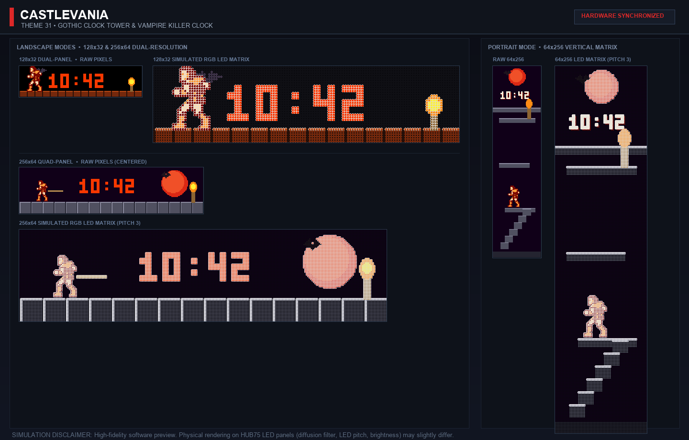

### 3. Super Mario Bros (NES) — Theme 30
*Mushroom Kingdom Overworld with 100% authentic SMB1 brick blocks; Mario runs across the screen and jumps under the digit block to trigger an elastic bounce and digit flip (with green Koopa shell kick and gold coin pop in 128x32 compact mode, and vertical 3-tier climb in portrait mode).*
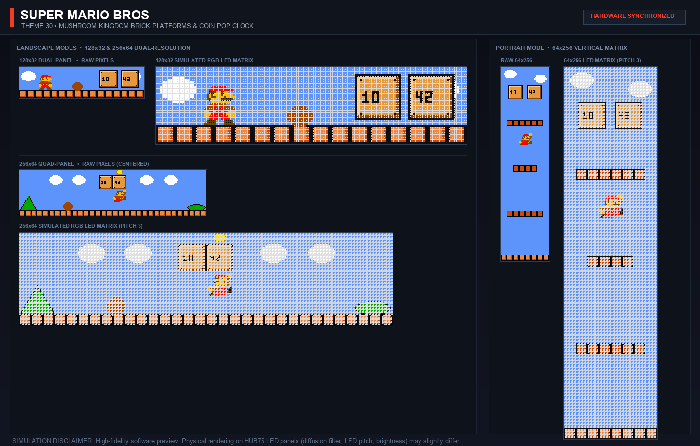

### 4. Mega Man (Capcom NES) — Theme 35
*Capcom Wily Castle fortress with separated technical platforms, life gauge, sleeping Metool, and Mega Man firing his Buster shot at the minute pod.*
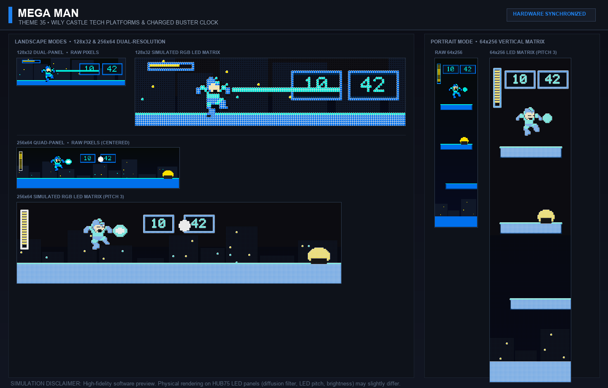

### 5. Sonic The Hedgehog (Sega Genesis) — Theme 39
*Green Hill Zone checkered platforms, spinning gold rings, red spring, Motobug badnik, and Sonic idle/spin-dash jumping animations.*
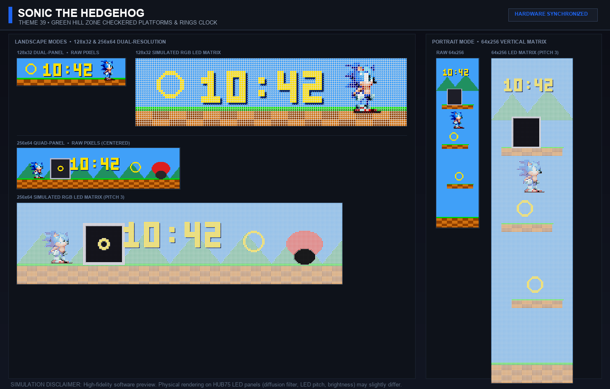

### 6. Pokémon Pokédex (Nintendo Game Boy) — Theme 32
*Authentic dual-screen Pokédex (Pocket Index) interface with creature inspection viewport, animated Pikachu sprite, PKMN font digital clock, live seconds telemetry bar, and blinking LED status sensor.*
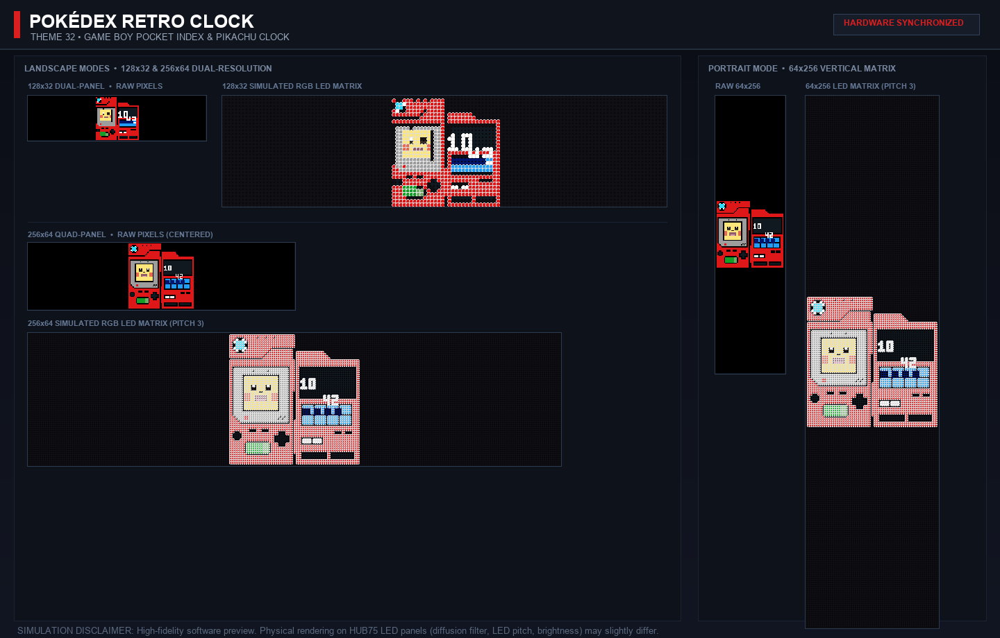

### 7. Pac-Man Arcade (Namco 1980) — Theme 26
*Original Namco arcade maze with blue neon corridors, energizers, dots, animated Pac-Man, and 4 chasing ghosts (Blinky, Pinky, Inky, Clyde).*
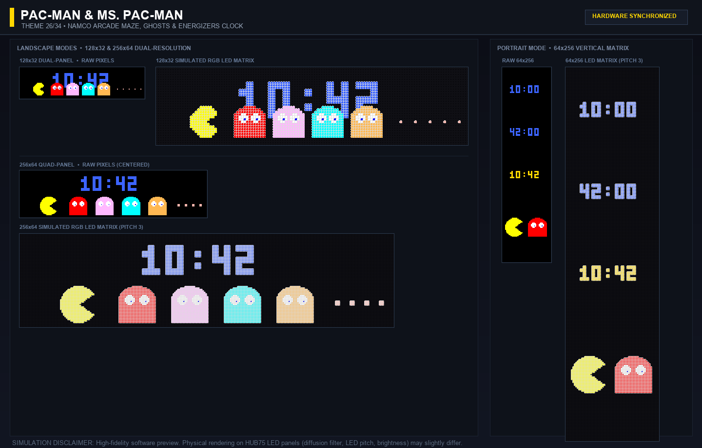

### 8. Russian Tetris (Alexey Pajitnov / Game Boy) — Theme 23
*Legendary falling block puzzle with dynamic 3D-beveled mino bricks (I, J, L, O, S, T, Z) cascading down to assemble the hours and minutes in real-time.*
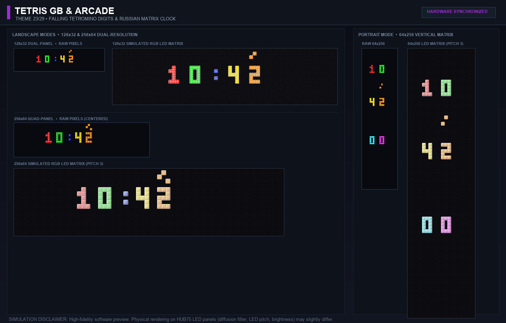

### 9. World Clock & Solar Terminator — Theme 33
*High-resolution continental world map with dynamic day/night solar terminator calculating real-time solar declination, local meridian marker, and dual UTC/local time.*
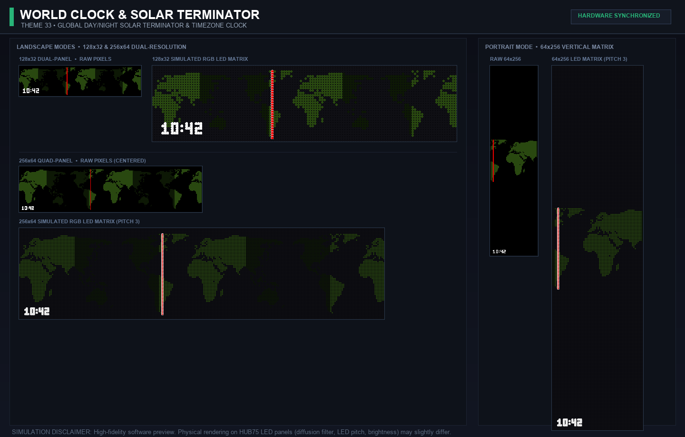

### 10. True Matrix Rain (The Wachowskis 1999) — Theme 21
*Iconic digital rain with phosphor green glyph cascades, randomized drop speeds, blazing white lead heads, fading persistence trails, and glowing neon clock digits.*
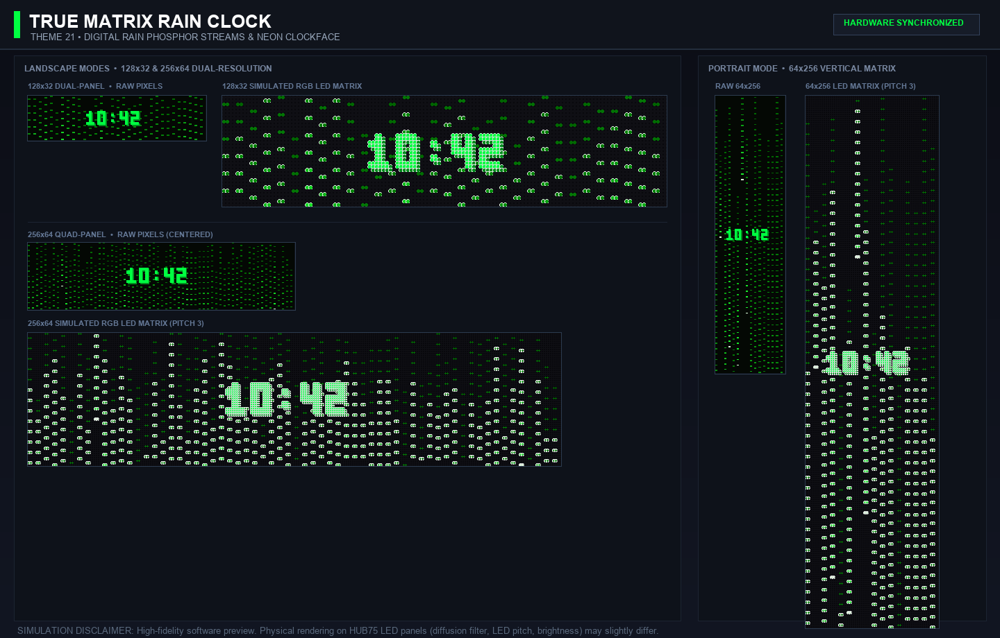

---

## 🚀 Hardware Requirements & Compatibility

Thanks to the ultra-lightweight native Rust implementation (~5 MB binary, ~10 MB RAM, 0% idle CPU overhead), **ArcadeMatrix now fully supports older legacy Raspberry Pi hardware without stutter or dropped frames**:

1. **Raspberry Pi**: 
   - **Legacy / Single-Core**: Pi 1 (B, B+, A+), Pi Zero, Pi Zero W *(Fully supported with zero lag thanks to Rust!)*
   - **Multi-Core**: Pi 2, Pi 3, Pi 4, Pi Zero 2 W *(Recommended)*
   - *(⚠️ **Pi 5 Warning**: The hzeller rgb-led-matrix library does NOT support the Pi 5 natively via GPIO due to the new RP1 chip. You must use an active adapter board for Pi 5!).*
2. **RGB LED Matrix**: HUB75 panels (e.g., 64x64, 128x32, 256x64).
3. **Adafruit RGB Matrix HAT** (or Joy-IT, or custom wiring).
4. **MicroSD Card** (16GB or larger recommended for the Pre-compiled Image).

---

## 🛠️ Advanced Installation

### Option 2: Manual Installation
If you prefer to install it manually on a fresh **Raspberry Pi OS Lite (64-bit)**:
Once logged into your Raspberry Pi via SSH:

```bash
curl -sSL https://raw.githubusercontent.com/red77290/ArcadeMatrix_RPI/main/autoInstall.sh | bash
```
*(If the repository is private, you will need to `git clone` manually first and run `./autoInstall.sh` from inside the folder).*

The script will automatically:
1. Install Rust, Actix-web, image-rs, and `build-essential`.
2. Download and compile the `hzeller/rpi-rgb-led-matrix` driver.
3. Setup `systemd` to automatically start ArcadeMatrix on boot.

### Option 3: Smart Deploy via Computer
If you want to compile the application on your own computer (much faster) and automatically deploy it to the Raspberry Pi, you can use the smart Docker-based deployment scripts.

**On macOS / Linux:**
```bash
bash scripts/deploy.sh --ip <PI_IP> --user <PI_USER> --pass <PI_PASS>
# Example: bash scripts/deploy.sh --ip 192.168.1.177 --user pi --pass raspberry
```

**On Windows (PowerShell):**
```powershell
.\scripts\deploy.ps1 -Ip "192.168.1.177" -User "pi" -Pass "raspberry"
```
*The script will auto-detect your Pi's architecture, compile the binary via Docker, stop the remote service, upload the file, and restart the application.*

---

## ⚠️ Hardware Warning: Wi-Fi & Interference (VHS Lines)

Raspberry Pis (especially Pi 3 and Zero W) share their internal Wi-Fi bus clock with the **PWM/PCM** hardware controller used by the LED matrix. 

When driving large matrices (like **256x64**), the DMA controller must push massive amounts of data to the GPIO pins. If hardware pulsing is enabled (`disable_hardware_pulsing = false`), this creates intense DMA bandwidth saturation that **starves the internal SDIO Wi-Fi chip**, causing severe packet loss, lag, and disconnections.

While an unstable Wi-Fi might be acceptable if you only use the Web UI occasionally to change the clock, it completely breaks features that rely on a stable internet connection or local network:
* **Recalbox/Batocera/Pixelcade MQTT Sync**: Will drop messages or disconnect.
* **Crypto & Stock Tickers**: API calls will timeout and fail.
* **Weather**: API calls will timeout.

**Solutions & Render Pipeline Selection:**

ArcadeMatrix RPi now features canonical `IDrawingSurface` abstraction with a configurable **Render Pipeline** selector in the Web UI (`#sys-tab-hardware`):

1. **`canvas_single` (Recommended / Default in `auto`)**: Single off-screen canvas with zero-copy row span presentation and `DirtyBounds` dirty line tracking. On static clock frames and slow-moving animations, `present()` immediately detects clean state and never touches the Broadcom memory bus or DMA engine. This completely **prevents SDIO Wi-Fi drops and buffer starvation** on Raspberry Pi!
2. **`canvas_double`**: Double-buffered off-screen canvas for maximum tear-free smoothness when Wi-Fi contention is not an issue (e.g. Ethernet / USB Wi-Fi).
3. **`direct_double`**: Direct hardware double-buffering via `rpi-rgb-led-matrix` C FFI.
4. **`direct_single`**: Direct hardware single frame-buffer.
5. **Use an Ethernet (RJ45) cable** (Pi 3B/4): Bypasses the SDIO Wi-Fi chip entirely.
6. **Use a USB Wi-Fi Dongle**: USB controllers use a different internal bus and are immune to the PWM DMA starvation.
7. **Set `disable_hardware_pulsing = true`**: Forces the matrix to use CPU bit-banging instead of hardware DMA. Your Wi-Fi will work perfectly, but you will see a slight "VHS lines" flickering effect on the matrix.

*(Note: **128x32** matrices require 4x less DMA bandwidth, so they usually run perfectly fine with hardware pulsing enabled and internal Wi-Fi active).*

*(Note on **Raspberry Pi 4**: The Pi 4 uses a much faster PCIe architecture and DMA controller. It is highly likely that it is NOT impacted by this 256x64 Wi-Fi saturation bug. However, this has not been officially tested yet as we do not have a Pi 4 on hand to confirm.)*

### Raspberry Pi Matrix Compatibility Table

| Matrix Size | Render Pipeline | Network / Pulse Configuration | Image Quality | Wi-Fi / API / MQTT |
|-------------|-----------------|-----------------------------|----------------|-------------------|
| **Any**     | **`canvas_single`** (Default) | Internal Wi-Fi + DMA Pulsing | ✅ Perfect (No flicker) | ✅ **100% Stable (Zero Drops)** |
| **128x32**  | Any Pipeline    | Internal Wi-Fi + `disable_hardware_pulsing = false` | ✅ Perfect | ✅ Stable |
| **256x64**  | `canvas_double` / `direct` | **Ethernet (RJ45)** + DMA Pulsing | ✅ Perfect | ✅ Stable |
| **256x64**  | `canvas_double` / `direct` | **USB Wi-Fi Dongle** + DMA Pulsing | ✅ Perfect | ✅ Stable |
| **256x64**  | `direct_single` | Internal Wi-Fi + `disable_hardware_pulsing = true` | ⚠️ Slight Flicker | ✅ Stable |
| **256x64**  | `direct_double` | Internal Wi-Fi + `disable_hardware_pulsing = false` | ✅ Perfect | ❌ Broken / Timeouts |

---

## 🎨 Media Management

The pre-compiled image features a dedicated **DATA partition** formatted as exFAT. This means you can plug your SD card directly into your Windows or Mac computer to drag-and-drop your files without needing SSH or FTP!

### Sprites & GIFs
* **`/fighters_32/`** or **`/fighters_64/`**: Put your `.fgt` sprites here (See MUGEN Sprites section below).
* **`/gifs/`**: Drop your `.gif` loops in folders inside here.
The Web UI will automatically scan these folders and let you check the ones you want to play!

### Fonts
* **`/fonts/`**: Drop your `.ttf`, `.otf`, or `.bdf` files here. 
By default, the project ships with `PressStart2P.ttf`, `VT323.ttf`, and `DotGothic16.ttf`.

---

## 🕸️ Web UI
Navigate to `http://<YOUR_PI_IP>:8080/` to access the Control Panel.

The interface is exactly the same as the ESP32 version, offering Dashboard controls, Playlist selection, Clock configuration, and MQTT settings, with added controls for **Gradients** and **Unlimited Sizes**.

---

## 🕹️ Recalbox & Batocera Integration (Pixelcade Marquees)

ArcadeMatrix supports dynamic **Pixelcade-style** marquees when you select or play a game on your Recalbox, Batocera, or RetroPie console!

> [!IMPORTANT]
> **Batocera version requirement:** Dynamic marquee switching while browsing games and systems requires **Batocera v33 or newer** (Batocera introduced the EmulationStation `game-selected` and `system-selected` script hooks in v33). On Batocera v32 and earlier, only game launch and stop events (`game-start`, `game-end`) are supported. Recalbox is fully supported across all versions via its native state polling daemon.

As you browse your game lists, the Raspberry Pi will download official Pixelcade marquees from GitHub **in the background and in real-time**, cache them on your SD card, and display them on your LED matrix. If a game has no image, it will display an elegant animated text fallback.

### Automatic Installation (Recommended)
Go to the **MQTT** tab in the ArcadeMatrix Web UI, select your console OS (`Auto-Detect`, `Recalbox`, `Batocera`, or `RetroPie`), enter the console's IP along with credentials, and click **Install Sync Script**. This will automatically inject the daemon via SSH.

### Manual Installation (Recalbox / Batocera / RetroPie)
If you prefer manual installation, or if the network install fails (see [tools/README.md](tools/README.md)):
1. Open or copy `tools/rpi_emulationstation_base_os_setup.sh` (or `tools/recalbox_setup_mqtt.sh`).
2. Copy the script to your console (e.g., via `scp`).
3. SSH into your console and run: `sh /tmp/rpi_emulationstation_base_os_setup.sh`.
4. Enter your ArcadeMatrix IP and select your target OS from the interactive menu.

### How does the Daemon architecture work?
Unlike native Recalbox scripts that run (and freeze the system) on every joystick movement, ArcadeMatrix installs an **ultra-lightweight Python/Shell Daemon (`arcadematrix_daemon.py`) in the background**.
* **Zero Lag:** Consumes 0% CPU. EmulationStation suffers no stutter or lag, even when scrolling at max speed.
* **Anti-Spam (Debounce):** If you scroll quickly through 50 games, the daemon won't flood the network. It only sends the message to the matrix if you pause on a game for more than 150 milliseconds.
* **Thread Safety:** On the LED Matrix side, downloads and the drawing engine are separated by threads with robust locks, preventing freezing and image cache corruption.

---

## 🔧 Matrix Configuration
If you have a matrix larger than 64x64 or 128x32, or if you are using a non-Adafruit HAT, you may need to tweak the `hzeller` arguments in `src/core/matrix.rs`. By default, it's set to `--led-gpio-mapping=adafruit-hat` and `128x32`.

You can also change Matrix brightness dynamically via the Web UI Settings.
- Enable Standby/Night modes.

---

## 📂 Managing Media (GIFs and MUGEN Sprites)

### Adding GIFs
Simply drop any standard `.gif` files into the `gifs/` directory:
```text
ArcadeMatrix_RPi/
└── gifs/
    ├── mario_run.gif
    ├── sonic_wait.gif
    └── ...
```

### Adding MUGEN Sprites
To achieve perfect 60fps performance and exact "virtual ground" alignments across massive character rosters, the Fighter engine uses pre-processed `.fgt` files along with an `index.txt` manifest.

**You cannot simply drop raw images into the fighters folders!**
You MUST use the provided `mugen_extractor.py` tool located in the `tools/mugen_extractor/` folder to process your MUGEN characters. 

The extractor will read MUGEN `.sff` and `.air` files, calculate the perfect bounding boxes to prevent animation jittering, and export optimized `.fgt` files directly into your `fighters_32/` and `fighters_64/` folders.

Please refer to `tools/mugen_extractor/README.md` for full instructions on how to add more MUGEN characters!

---

## ⚙️ Advanced Configuration (config.json)

If you prefer to edit settings manually instead of using the Web UI, you can directly edit the `config.json` file located on the **DATA** partition of your SD Card. This is especially useful for setting up Wi-Fi before the first boot.

> ℹ️ ArcadeMatrix uses a single structured **`config.json`** (the legacy `conf.ini` format has been removed). The file is **self-healing**: any missing key is recreated with its default on boot, so a partial hand-edit is always safe.

```json
{
  "matrix": { "width": 64, "height": 32, "chain_length": 1, "mapping": "adafruit-hat",
              "rgb_sequence": "RGB", "slowdown": 2, "disable_hardware_pulsing": false },
  "wifi":   { "ssid": "YourNetwork", "password": "YourPassword", "configured": false,
              "disable_internal": false },
  "mqtt":   { "enabled": false, "broker": "192.168.1.50", "port": 1883 },
  "system": { "format_24h": true, "lang": "en", "night_mode_enabled": false,
              "turn_off_at": "23:00", "wake_up_at": "07:00", "night_brightness": 20 },
  "instances": [
    { "instance_id": "clock_main", "engine_id": "clock",
      "config": { "theme": "0", "font": "DotGothic16.ttf", "size": "16" } }
  ],
  "rotation": [ { "instance_id": "clock_main", "duration_sec": 30 } ],
  "api_auth_enabled": false,
  "api_token": ""
}
```

Key points:
* **`matrix`** — hardware driver (panel size, `mapping`, `rgb_sequence`, `slowdown`, `disable_hardware_pulsing`, ...). Editing it triggers an automatic restart.
* **`wifi`** — set `configured: false` to force a (re)connection attempt on the next boot (auto-set back to `true` on success). Use `disable_internal: true` with an external USB dongle.
* **`mqtt`** — Recalbox/Batocera marquee sync (see below).
* **`system`** — timezone, language, 24h format, and the Night/Standby schedule (`night_brightness: 0` fully turns the panel off).
* **`instances` / `rotation`** — each engine is a self-contained *instance*; `rotation` decides the display order and per-slot `duration_sec`. Editing an instance from the Web UI applies **live, without a restart**.
* **`api_auth_enabled` / `api_token`** — when enabled, sensitive endpoints require the `X-API-Token` header (see the API note below).

👉 **Full field-by-field reference:** [docs/CONFIGURATION.md](docs/CONFIGURATION.md).

### 🔒 API Authentication
`api_auth_enabled` is `false` by default so the bundled Web UI works out of the box. Set it to `true` (and copy the auto-generated `api_token`) to require the `X-API-Token` header on sensitive endpoints such as `/api/wifi`, `/api/mqtt/install`, `/api/system/reboot`, and `/api/system/shutdown`. Enable it whenever the device is reachable beyond a trusted LAN.

## 🙏 Acknowledgments

A huge thanks to the open-source community and the creators of the incredible libraries that power this project:
- **[rpi-rgb-led-matrix](https://github.com/hzeller/rpi-rgb-led-matrix)** by hzeller (and the Rust bindings by AidanWallace)
- **[Actix-web](https://github.com/actix/actix-web)** for the blazing fast web API
- **[image-rs](https://github.com/image-rs/image)** for image processing
- **[rumqttc](https://github.com/bytebeamio/rumqtt)** for MQTT support
- **[@TooncesToo](https://github.com/TooncesToo)** for implementing the network GIF library API, multi-file uploader, and Web UI file manager with dual-orientation support on both Raspberry Pi and ESP32.
- And the entire Rust community for creating such an amazing ecosystem (Tokio, Serde, reqwest, tracing, etc.)!

Special thanks to the **RPiTeam** for the awesome pack of 600 GIFs!

## ☕ Support the Project

[](https://ko-fi.com/red1l)

If you enjoy this project and want to support its ongoing development, feel free to [buy me a coffee on Ko-fi](https://ko-fi.com/red1l). It is completely voluntary, no strings attached, and nothing expected in return — just a kind gesture that fuels motivation and testing on new hardware!

## 📜 License
This project is licensed under the **[MIT License](LICENSE)**.

**In short:** you are free to use, modify, distribute, and sublicense this software for any purpose, personal or commercial, provided that the original copyright notice and permission notice are preserved. See the full [LICENSE](LICENSE) file for details.
