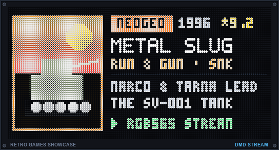
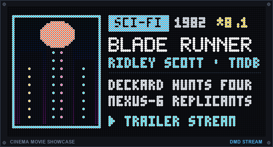
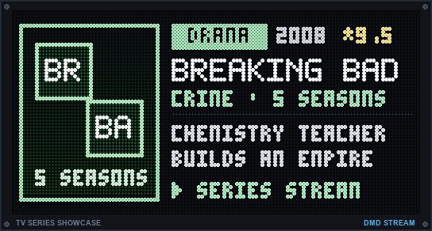
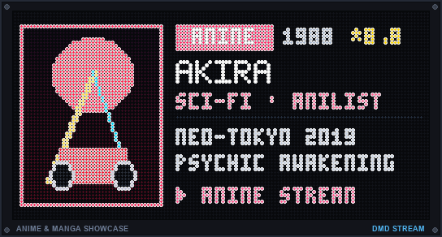

🇬🇧 [English](README.md) | 🇫🇷 Français | 🇪🇸 [Español](README_ES.md)

# ArcadeMatrix RPi 🍓👾

[](https://t.me/+DrSdAO8UMUViNmE0)
[](https://ko-fi.com/red1l)

💬 **Communauté Telegram :** [https://t.me/+DrSdAO8UMUViNmE0](https://t.me/+DrSdAO8UMUViNmE0)  
📺 **Démo Vidéo / Présentation :** https://youtu.be/vAK880Io8yo?si=KSieTymlE7fLyZQs

L'implémentation **Rust** originale du projet **ArcadeMatrix**, spécialement conçue pour fonctionner sur un **Raspberry Pi** connecté à une matrice LED RGB (HUB75) via le HAT Adafruit ou le matériel Joy-IT.

Développée en parallèle de la version ESP32 C++, cette version tire parti de la puissance du Raspberry Pi pour offrir un pipeline graphique multi-threadé haute performance.

📚 **Documentation développeur :** [Premiers pas (workspace dev)](docs/GETTING_STARTED_FR.md) · [Guide développeur](docs/DEVELOPER_FR.md) · [Architecture](docs/ARCHITECTURE_FR.md) · [Guide rapide (utilisateurs finaux)](docs/QUICKSTART_FR.md)

---

## 💾 Guide Rapide : Image précompilée (Recommandé)

Nous fournissons des fichiers `.img` précompilés et entièrement automatisés, publiés automatiquement à chaque nouvelle version.

| Architecture | Recommandé pour | Compatible avec | Télécharger |
|--------------|-----------------|-----------------|-------------|
| **64-bits (aarch64)** | Raspberry Pi 3, 4, 5, Zero 2 W | Pi 3, 4, 5, Zero 2 W | [⬇️ Télécharger Image 64-bits](https://github.com/red77290/ArcadeMatrix_RPI/releases/latest/download/ArcadeMatrix_Release_aarch64.img.xz) |
| **32-bits (armhf)** | Raspberry Pi 1, 2, Zero (Original) | Tous les modèles Raspberry Pi | [⬇️ Télécharger Image 32-bits](https://github.com/red77290/ArcadeMatrix_RPI/releases/latest/download/ArcadeMatrix_Release_armhf.img.xz) |

*(Ce sont des fichiers `.img.xz` — décompressez avec 7-Zip/Keka/`xz -d` avant le flash. Voir la [liste complète des releases](https://github.com/red77290/ArcadeMatrix_RPI/releases) pour les anciennes versions.)*

1. Flashez le `.img` sur votre carte SD avec **Raspberry Pi Imager**.
2. Une fois le flash terminé, réinsérez la carte SD dans votre PC/Mac. Vous verrez apparaître un lecteur USB **DATA** de 8 Go !
3. Ouvrez le fichier `config.json` situé sur ce lecteur DATA pour configurer la taille de votre matrice et vos identifiants **Wi-Fi** (`"ssid"` et `"password"`).
4. Insérez la carte SD dans votre Raspberry Pi et allumez-le.
5. La matrice s'allumera immédiatement et **affichera l'adresse IP** pendant 5 secondes. Utilisez cette IP pour accéder à l'interface Web !

---

## 🕹️ Moteurs Intégrés & Simulations Matérielles

Chaque moteur d'ArcadeMatrix RPi est conçu en Rust multi-threadé avec **zéro allocation dynamique lors de la boucle de rendu**, garantissant une cadence d'affichage de 60 FPS. Voici les simulations fidèles de chaque moteur en fonctionnement sur dalles physiques HUB75 :

| Moteur / ID | Simulation Matérielle | Description & Fonctionnalités Clés |
| :--- | :---: | :--- |
| **Desk Master Dashboard**<br>`dashboard` |  | Horloge de bureau complète avec cadran analogique pixel-art, balayage fluide de trotteuse, horloges mondiales, météo en direct OpenWeatherMap, et bandeau ticker live cryptos Binance & actions Yahoo Finance. |
| **Horloge Rétro Gaming**<br>`clock` | <br><br>[👉 **Voir la galerie des 10+ horloges rétro ➔**](#-collection-signature-dhorloges-rétro-thématiques) | Collection exclusive d'horloges animées d'arcade et de consoles rétro (Metal Slug, Castlevania, Mario, Mega Man, Sonic, Pokédex, Pac-Man, Tetris, Horloge Mondiale, Pluie Matrix...) avec sprites 100 % authentiques au pixel près. |
| **Combattants Arcade M.U.G.E.N**<br>`fighter` *(Overlay Transverse)* |  | Rendu d'overlay transverse (`system.idle_fighter_enabled`, et non un moteur de rotation autonome) affichant de véritables sprites de jeux de combat rétro (Street Fighter, King of Fighters, etc.) avec barres de vie en temps réel, arènes personnalisées et duels IA au-dessus des horloges et de la date. |
| **Spotify Now Playing**<br>`spotify` |  | Affichage en direct du morceau en cours avec pochette d'album en couleur, défilement artiste/titre, mini barres d'égaliseur animées et barre de progression. |
| **Google Cast & Nest**<br>`google_cast` |  | Découverte automatique mDNS des enceintes Google Home / Nest Audio avec affichage des pochettes, volume et progression de lecture en streaming. |
| **Ticker & Graphique Crypto**<br>`crypto` |  | Cotations en direct Binance / CoinGecko, badge de variation sur 24h et courbes sparklines historiques en temps réel avec cache TTL intelligent. |
| **Ticker Bourse & Actions**<br>`stock` |  | Cotations en temps réel Yahoo Finance, badges de variation 1D % et graphiques d'aires sparkline intrajournaliers pour actions et ETF NASDAQ/S&P. |
| **Météo Dynamique**<br>`weather` |  | Conditions extérieures en direct, températures max/min, humidité, vent et icônes rétro animées via OpenWeatherMap & Open-Meteo. |
| **HUD Télémétrie Système**<br>`system_info` |  | Moniteur double colonne en temps réel de l'utilisation CPU (%), RAM (%), température matérielle du SoC Raspberry Pi (°C/°F) et Uptime avec jauges colorées. |
| **Ticker Actualités en Direct**<br>`gnews` |  | Derniers grands titres en temps réel avec badges de catégories (`[TECH]`, `[MONDE]`, `[ÉCO]`), balise clignotante de direct et bandeau défilant fluide à 60 FPS. |
| **Home Assistant & MQTT**<br>`mqttdata` |  | Tableaux de bord Home Assistant, valeurs de capteurs, graphiques historiques sur 24h et météo locale diffusés via MQTT avec blueprints prêts à l'emploi. |
| **Retro Games Showcase**<br>`retro_games` |  | Diffuse des jaquettes de consoles et bornes d'arcade rétro, badges de systèmes, synopsis traduits et vidéos de gameplay RGB565 à 30 FPS.<br>⚠️ **Fonctionne uniquement avec [dmd_media_showcase](https://github.com/red77290/dmd_media_showcase)** installé sur une autre machine du même réseau local. |
| **Movie Showcase**<br>`movie_showcase` |  | Vitrine cinéma diffusant les affiches de films TMDB/TVDB, notes, synopsis traduits et bandes-annonces vidéo RGB565 à 30 FPS.<br>⚠️ **Fonctionne uniquement avec [dmd_media_showcase](https://github.com/red77290/dmd_media_showcase)** installé sur une autre machine du même réseau local. |
| **Series Showcase**<br>`series_showcase` |  | Vitrine séries TV affichant les affiches de séries, années de sortie, notes étoiles, synopsis traduits et bandes-annonces RGB565 à 30 FPS.<br>⚠️ **Fonctionne uniquement avec [dmd_media_showcase](https://github.com/red77290/dmd_media_showcase)** installé sur une autre machine du même réseau local. |
| **Anime Showcase**<br>`anime_showcase` |  | Vitrine anime et manga propulsée par AniList/Jikan/Kitsu avec couvertures, synopsis traduits et extraits vidéo RGB565 à 30 FPS.<br>⚠️ **Fonctionne uniquement avec [dmd_media_showcase](https://github.com/red77290/dmd_media_showcase)** installé sur une autre machine du même réseau local. |
| **Lecteur GIF Animés**<br>`gifs` |  | Lecture fluide à 60 FPS d'animations rétro et de playlists locales ou réseau avec accélération de présentation par tranches de lignes zéro-copie. |
| **Bandeau Défilant Marquee**<br>`message` |  | Enseignes matricielles personnalisables avec typographie ambrée lumineuse, multiples directions de défilement et déclencheurs API REST. |
| **Marquee Borne d'Arcade**<br>`marquee` |  | Affichage des marquees de jeux d'arcade officiels via intégration Pixelcade pour configurations Batocera, Recalbox et RetroPie. |
| **Calendrier & Date**<br>`date` |  | Grande date au style arcade avec ombres portées 3D Capcom/Nintendo, support multilingue (FR, EN, ES) et synchronisation NTP. |

> [!NOTE]
> **Avertissement sur le rendu matériel :** Les captures d'écran, visuels d'aperçu des moteurs et posters d'horloges présentés dans cette documentation sont des simulations logicielles haute fidélité destinées à illustrer la mise en page, les animations et la disposition des éléments. Le rendu visuel réel sur un panneau LED HUB75 physique peut légèrement différer selon le pas de masque (pitch), le filtre diffuseur acrylique, la luminosité des LEDs et l'éclairage ambiant.

### 🌟 Points Forts de l'Architecture (Exclusivités RPi & Alignement ESP32)

* 🎯 **Moteur d'Arbitrage et de Préemption Canonique (`DisplayArbiter`)** : pipeline de décision borné en $O(1)$ zéro-allocation avec arbitrage de priorité (`Rotation` 10 $\to$ `GIF` 20 $\to$ `Marquee` 30 $\to$ `MQTT` 40), `PreemptionStack<4>`, identité d'intention stricte et nettoyage résilient des sessions orphelines.
* 🧭 **Orientation Réactive & Mode Tate (`OrientationManager`)** : gestion multi-angles manuelle (0°, 90°, 180°, 270°) avec classification automatique du gabarit (`LayoutClass`) et versioning réactif (`DisplayGeometry`).
* 🔄 **Mises à jour Over-The-Air (OTA)** : mettez à jour le binaire Rust directement depuis l'interface Web sans re-flasher votre image de carte SD ! *(Secours / Failsafe : Si une mise à jour OTA casse votre système, branchez votre carte SD sur un PC et déposez un firmware valide nommé `arcadematrix_recovery.bin` à la racine de la partition `bootfs` OU de la partition `DATA`. Il s'installera automatiquement au prochain démarrage !)*
* 🚀 **Performances Rust natives multi-threadées & Gouvernance Mémoire Transparente (`core::memory`)** : moteur multi-threadé hautes performances utilisant Actix-web, réclamation automatique de la mémoire transitoire à chaque transition de moteur (`ManagedEngineWrapper` + `malloc_trim(0)`), garde-fou RSS périodique et pools de clients HTTP partagés bornés.
* ⚡ **Pipeline Canvas Zéro-Copie DirtyBounds (`canvas_single`)** : canevas unique hors-écran avec présentation par tranches de lignes sans copie et suivi de lignes modifiées `DirtyBounds`. Élimine totalement les coupures et interférences Wi-Fi SDIO sur Broadcom !
* 🗂️ **Bibliothèque GIF Réseau & Gestionnaire de Fichiers Web (`/api/gifs/*`)** : gestion complète des playlists GIF directement depuis la Web UI ! Parcourez les dossiers de playlists, téléversez des GIF animés par Wi-Fi/Ethernet, créez/supprimez des dossiers, renommez et réindexez automatiquement en arrière-plan. Support natif double orientation (`?orientation=yoko|tate`) pour affichages horizontaux (Yoko) et verticaux (Tate) — réalisé par [@TooncesToo](https://github.com/TooncesToo) !
* 🔤 **Polices chargeables dynamiquement (`.ttf`)** : déposez n'importe quelle police `.ttf` ou `.otf` directement dans le dossier `fonts/`, et l'interface Web la listera automatiquement pour l'utiliser sur l'horloge ou la date.
* 🌧️ **Véritable pluie numérique Matrix (Katakana)** : un effet Matrix entièrement personnalisé, ultra fluide et authentique (`DotGothic16`) avec des Katakana demi-largeur qui tombent et un texte en espace négatif d'« LED éteintes » qui perce la pluie.

---

## 🎨 Collection Signature d'Horloges Rétro Thématiques

ArcadeMatrix RPi inclut une collection signature d'horloges rétro arcade et consoles fabriquées sur mesure, synchronisées avec le matériel et rendues avec 100 % de sprites originaux fidèles au pixel près à 60 FPS, avec prise en charge multi-résolution pour formats Paysage (64x64, 128x32, 256x64) et Portrait / Tate (32x64, 64x128, 64x256) :

### 1. Metal Slug : Super Vehicle-001 (SNK Neo Geo) — Thème 41
*Pixel art SNK Neo Geo authentique avec décor de souk du désert arabe, animations de combat de Marco Rossi, char Di-Cokka rebelle, hélicoptère de patrouille et tirs de mitrailleuse lourde.*


### 2. Castlevania (Konami NES) — Thème 31
*Beffroi gothique avec Simon Belmont montant le grand escalier de pierre vers la chambre de Dracula, torche sur pied authentique, chauve-souris vampire battant des ailes devant la lune de sang et chiffres ivoire haute lisibilité.*


### 3. Super Mario Bros (NES) — Thème 30
*Overworld du Royaume Champignon avec blocs de briques 100 % fidèles à la NES ; Mario court à travers l'écran et saute sous le bloc des chiffres pour déclencher un rebond élastique et la bascule de la minute (avec coup de carapace Koopa verte et pop de pièce d'or en mode 128x32 compact, et ascension sur 3 étages en mode portrait).*


### 4. Mega Man (Capcom NES) — Thème 35
*Forteresse du Dr. Wily Capcom avec plateformes techniques séparées, jauge de vie, Metool endormi et Mega Man tirant son Buster chargé sur le pod des minutes.*


### 5. Sonic The Hedgehog (Sega Mega Drive / Genesis) — Thème 39
*Plateformes à damier de Green Hill Zone, anneaux d'or tournoyants, ressort rouge, badnik Motobug et animations idle / saut en boule spin-dash de Sonic.*


### 6. Pokédex Pokémon (Nintendo Game Boy) — Thème 32
*Interface double écran Pokédex (Pocket Index) avec fenêtre d'inspection de créature, sprite Pikachu animé, horloge numérique en typographie PKMN, barre de télémétrie des secondes et voyant LED clignotant.*


### 7. Pac-Man Arcade (Namco 1980) — Thème 26
*Labyrinthe d'arcade Namco original avec couloirs néon bleus, pac-gommes, super-gommes, Pac-Man animé et les 4 fantômes poursuivants (Blinky, Pinky, Inky, Clyde).*


### 8. Tetris Russe (Alexey Pajitnov / Game Boy) — Thème 23
*Célèbre puzzle de briques tombantes avec tétraminos 3D biseautés (I, J, L, O, S, T, Z) s'assemblant en cascade pour former les heures et les minutes en temps réel.*


### 9. Horloge Mondiale & Terminateur Solaire — Thème 33
*Carte mondiale continentale haute résolution avec terminateur solaire jour/nuit dynamique calculant la déclinaison solaire en temps réel, marqueur de méridien local et double affichage heure UTC / locale.*


### 10. Véritable Pluie Numérique Matrix (Les Wachowski 1999) — Thème 21
*Pluie numérique emblématique avec cascades de glyphes vert phosphore, vitesses de chute aléatoires, têtes de ligne blanches incandescentes, traînées rémanentes et chiffres néon rayonnants.*


---

## 🚀 Prérequis matériels & Compatibilité

Grâce à l'implémentation Rust natif ultra-léger (~5 Mo de binaire, ~10 Mo de RAM, 0% d'utilisation CPU au repos), **ArcadeMatrix prend désormais pleinement en charge les anciennes générations de Raspberry Pi sans aucun ralentissement ni baisse de framerate** :

1. **Raspberry Pi** : 
   - **Anciens modèles / Mono-cœur** : Pi 1 (B, B+, A+), Pi Zero, Pi Zero W *(Pleinement pris en charge avec 0 lag grâce à Rust !)*
   - **Multi-cœurs** : Pi 2, Pi 3, Pi 4, Pi Zero 2 W *(Recommandé)*
   - *(⚠️ **Avertissement Pi 5** : La bibliothèque hzeller rgb-led-matrix ne prend PAS en charge nativement le Pi 5 via GPIO à cause de la nouvelle puce RP1. Vous devez utiliser une carte adaptatrice active pour Pi 5 !).*
2. **Matrice LED RGB** : panneaux HUB75 (ex. 64x64, 128x32, 256x64).
3. **Adafruit RGB Matrix HAT** (ou Joy-IT, ou câblage personnalisé).
4. **Carte MicroSD** (16 Go ou plus recommandés pour l'image précompilée).

---

## 🛠️ Installation Avancée

### Option 2 : installation manuelle
Si vous préférez l'installer manuellement sur un **Raspberry Pi OS Lite (64-bit)** fraîchement installé :
Une fois connecté à votre Raspberry Pi en SSH :

```bash
curl -sSL https://raw.githubusercontent.com/red77290/ArcadeMatrix_RPI/main/autoInstall.sh | bash
```
*(Si le dépôt est privé, vous devrez d'abord faire le `git clone` manuellement puis exécuter `./autoInstall.sh` depuis le dossier.)*

Le script va automatiquement :
1. Installer Rust, Actix-web, image-rs et `build-essential`.
2. Télécharger et compiler le pilote `hzeller/rpi-rgb-led-matrix`.
3. Configurer `systemd` pour démarrer automatiquement ArcadeMatrix au boot.

### Option 3 : Installation depuis un ordinateur via script (Smart Deploy)
Si vous souhaitez compiler l'application sur votre propre ordinateur (beaucoup plus rapide) et la déployer automatiquement sur le Raspberry Pi, vous pouvez utiliser les scripts de déploiement intelligents basés sur Docker.

**Sur macOS / Linux :**
```bash
bash scripts/deploy.sh --ip <PI_IP> --user <PI_USER> --pass <PI_PASS>
# Exemple : bash scripts/deploy.sh --ip 192.168.1.177 --user pi --pass raspberry
```

**Sur Windows (PowerShell) :**
```powershell
.\scripts\deploy.ps1 -Ip "192.168.1.177" -User "pi" -Pass "raspberry"
```
*Le script détectera automatiquement l'architecture de votre Pi, compilera le binaire via Docker, arrêtera le service distant, enverra le fichier et relancera l'application.*

---

## ⚠️ Avertissement Matériel : Wi-Fi & Interférences (Lignes VHS)

Les Raspberry Pi (particulièrement les Pi 3 et Zero W) partagent l'horloge de leur bus Wi-Fi interne avec le contrôleur **PWM/PCM** utilisé par la matrice LED.

Lorsque l'on pilote de très grandes matrices (comme du **256x64**), le contrôleur DMA doit pousser une quantité massive de données vers les broches GPIO. Si le pulsing matériel est activé (`disable_hardware_pulsing = false`), cela crée une intense saturation de la bande passante DMA qui **asphyxie la puce Wi-Fi interne (SDIO)**, provoquant de sévères pertes de paquets, du lag, et des déconnexions.

Bien qu'un Wi-Fi instable puisse être tolérable si vous utilisez l'interface Web uniquement pour changer l'horloge de temps en temps, cela casse complètement les fonctionnalités qui dépendent d'une connexion internet ou locale stable :
* **Recalbox/Batocera/Pixelcade (MQTT)** : Perte des messages ou déconnexion du broker.
* **Crypto & Bourse (Stocks)** : Les appels API vont subir des timeouts et échoueront.
* **Météo (Weather)** : Les appels API échoueront.

**Solutions & Sélection du Pipeline de Rendu :**

ArcadeMatrix RPi intègre désormais l'abstraction canonique `IDrawingSurface` avec un sélecteur configurable de **Pipeline de Rendu** dans l'interface Web (`#sys-tab-hardware`) :

1. **`canvas_single` (Recommandé / Par défaut en mode `auto`)** : Canevas hors-écran unique avec présentation par plages de lignes zéro-copie et détection des zones sales `DirtyBounds`. Sur les images fixes d'horloges et les animations calmes, `present()` détecte immédiatement l'état clean et ne sollicite jamais inutilement le bus mémoire Broadcom ni le moteur DMA. Cela **supprime totalement les déconnexions Wi-Fi SDIO et la famine de bus** sur Raspberry Pi !
2. **`canvas_double`** : Double canevas hors-écran avec swap de buffers pour une fluidité sans déchirement maximale lorsque la contention Wi-Fi n'est pas un problème (ex. Ethernet / Wi-Fi USB).
3. **`direct_double`** : Double-buffer matériel direct via le FFI C de `rpi-rgb-led-matrix`.
4. **`direct_single`** : Framebuffer direct matériel unique.
5. **Utiliser un câble Ethernet (RJ45)** (Pi 3B/4) : Contourne complètement la puce Wi-Fi SDIO.
6. **Utiliser un Dongle Wi-Fi USB** : Les contrôleurs USB utilisent un bus interne différent et sont immunisés contre la saturation DMA du PWM.
7. **Mettre `disable_hardware_pulsing = true`** : Force la matrice à utiliser un rendu logiciel (CPU bit-banging) au lieu du DMA matériel. Votre Wi-Fi fonctionnera à la perfection, mais vous verrez un léger effet de "lignes VHS" (scintillement) sur la matrice.

*(Note : Les matrices **128x32** nécessitent 4 fois moins de bande passante DMA, elles fonctionnent donc généralement très bien avec le pulsing matériel activé et le Wi-Fi interne).*

*(Note concernant le **Raspberry Pi 4** : Le Pi 4 utilise une architecture PCIe et un contrôleur DMA beaucoup plus rapides. Il est très probable qu'il ne soit PAS impacté par ce bug de saturation Wi-Fi en 256x64. Cependant, cela n'a pas encore été testé officiellement car nous n'avons pas de Pi 4 sous la main pour le confirmer.)*

### Tableau de Compatibilité Raspberry Pi & Résolution

| Résolution de la matrice | Pipeline de Rendu | Configuration Réseau / Hardware Pulsing | Qualité d'Image | Wi-Fi / APIs / MQTT |
|-------------|-------------------|-----------------------------|----------------|-------------------|
| **Toutes**  | **`canvas_single`** (Défaut) | Wi-Fi Interne + DMA Pulsing | ✅ Parfaite (0 scintillement) | ✅ **100% Stable (Zéro Déconnexion)** |
| **128x32**  | Tout pipeline     | Wi-Fi Interne + `disable_hardware_pulsing = false` | ✅ Parfaite | ✅ Stable |
| **256x64**  | `canvas_double` / `direct` | **Câble Ethernet (RJ45)** + DMA Pulsing | ✅ Parfaite | ✅ Stable |
| **256x64**  | `canvas_double` / `direct` | **Dongle Wi-Fi USB** + DMA Pulsing | ✅ Parfaite | ✅ Stable |
| **256x64**  | `direct_single`   | Wi-Fi Interne + `disable_hardware_pulsing = true` | ⚠️ Léger scintillement | ✅ Stable |
| **256x64**  | `direct_double`   | Wi-Fi Interne + `disable_hardware_pulsing = false` | ✅ Parfaite | ❌ Crash Wi-Fi / Timeouts |

---

## 🎨 Gestion des médias

L'image précompilée inclut une **partition DATA dédiée de 8 Go** formatée en exFAT. Cela signifie que vous pouvez brancher directement votre carte SD sur votre ordinateur Windows ou Mac pour glisser-déposer vos fichiers sans avoir besoin de SSH ni de FTP !

### Sprites & GIFs
* **`/fighters_32/`** ou **`/fighters_64/`** : placez ici vos sprites `.fgt` (voir la section Sprites MUGEN ci-dessous).
* **`/gifs/`** : déposez vos boucles `.gif` dans des dossiers à l'intérieur.
L'interface Web analysera automatiquement ces dossiers et vous permettra de cocher ceux que vous voulez lire !

### Fonts
* **`/fonts/`** : déposez ici vos fichiers `.ttf`, `.otf` ou `.bdf`. 
Par défaut, le projet est livré avec `PressStart2P.ttf`, `VT323.ttf` et `DotGothic16.ttf`.

---

## 🕸️ Interface Web
Naviguez vers `http://<YOUR_PI_IP>:8080/` pour accéder au panneau de contrôle.

L'interface est alignée sur la version ESP32, avec les contrôles du Dashboard, la sélection de Playlist, la configuration de l'horloge, les paramètres Showcase Server et MQTT, ainsi que des contrôles supplémentaires pour les **Gradients** et les **Unlimited Sizes**.

---

## 🎬 Intégration du Serveur Media Showcase ([dmd_media_showcase](https://github.com/red77290/dmd_media_showcase))

Les 4 moteurs Showcase (`retro_games`, `movie_showcase`, `series_showcase`, `anime_showcase`) **fonctionnent exclusivement avec l'application compagnon [dmd_media_showcase](https://github.com/red77290/dmd_media_showcase) installée sur une autre machine du même réseau local** (NAS, serveur Docker, PC ou un autre Raspberry Pi) afin de diffuser les affiches pré-rendues en RGB565, panoramas, synopsis multilingues (synchronisés automatiquement sur la langue configurée du DMD : `fr`, `en`, `es`, `de`, `it`) et bandes-annonces/vidéos de gameplay RGB565 à 30 FPS :
1. Installez et démarrez **[dmd_media_showcase](https://github.com/red77290/dmd_media_showcase)** sur une machine de votre réseau local (elle s'annonce automatiquement sur le réseau sous le nom `http://dmdmediashowcase.local:8890`).
2. Dans l'onglet **Settings** de la Web UI d'ArcadeMatrix (`MQTT & API` -> **🎬 DMD Media Showcase**), l'URL du serveur est **déjà pré-remplie** avec `http://dmdmediashowcase.local:8890` et **Désactivée par défaut** (`showcase.enabled = false`) pour éviter tout accès réseau inutile tant que l'application n'est pas installée. Il suffit de passer **Activer DMD Media Showcase** sur **Activé**, d'enregistrer, et de vérifier que le témoin lumineux affiche **`🟢 Communication OK (v3.0.0)`**.
3. Ajoutez `retro_games`, `movie_showcase`, `series_showcase` ou `anime_showcase` à votre rotation (`display_duration_sec` de `15` à `120` secondes). Chaque moteur Showcase respecte automatiquement son budget de durée configuré afin que les séquences Poster + Synopsis + Vidéo ne soient jamais coupées prématurément.

---

## 🕹️ Intégration Recalbox & Batocera (Pixelcade Marquees)

ArcadeMatrix prend en charge les marquees dynamiques **style Pixelcade** lorsque vous sélectionnez ou lancez un jeu sur votre console Recalbox, Batocera ou RetroPie !

> [!IMPORTANT]
> **Version minimale de Batocera requise :** La synchronisation dynamique des marquees pendant la navigation dans les listes de jeux et de systèmes requiert **Batocera v33 ou supérieur** (Batocera a introduit les hooks de script EmulationStation `game-selected` et `system-selected` à partir de la version 33). Sur Batocera v32 et versions antérieures, seuls les événements de lancement et d'arrêt de jeu (`game-start`, `game-end`) sont supportés. Recalbox est intégralement pris en charge sur toutes ses versions grâce à son démon de scrutation d'état natif.

Quand vous parcourez vos listes de jeux, le Raspberry Pi télécharge les marquees officielles Pixelcade depuis GitHub **en arrière-plan et en temps réel**, les met en cache sur votre carte SD et les affiche sur votre matrice LED. Si un jeu n'a pas d'image, il affichera un élégant texte animé de repli.

### Installation automatique (recommandée)
Allez dans l'onglet **MQTT** de l'interface Web ArcadeMatrix, choisissez l'OS de votre console (`Détection auto`, `Recalbox`, `Batocera` ou `RetroPie`), saisissez l'IP de la console ainsi que ses identifiants et cliquez sur **Install Sync Script**. Cela injectera automatiquement le daemon via SSH.

### Installation manuelle (Recalbox / Batocera / RetroPie)
Si vous préférez l'installation manuelle, ou si l'installation réseau échoue (voir [tools/README_FR.md](tools/README_FR.md)) :
1. Ouvrez ou copiez `tools/rpi_emulationstation_base_os_setup.sh` (ou `tools/recalbox_setup_mqtt.sh`).
2. Copiez le fichier sur votre console (ex : via `scp`).
3. Connectez-vous en SSH à votre console et exécutez : `sh /tmp/rpi_emulationstation_base_os_setup.sh`.
4. Saisissez l'IP de votre ArcadeMatrix et choisissez votre système cible dans le menu interactif.

### Comment fonctionne l'architecture du daemon ?
Contrairement aux scripts natifs Recalbox qui s'exécutent (et figent le système) à chaque mouvement de joystick, ArcadeMatrix installe **un daemon Python/Shell ultra-léger (`arcadematrix_daemon.py`) en arrière-plan**.
* **Zéro lag :** consomme 0 % de CPU. EmulationStation ne subit aucun stutter ni lag, même en défilant à vitesse maximale.
* **Anti-spam (debounce) :** si vous parcourez rapidement 50 jeux, le daemon n'inondera pas le réseau. Il n'envoie le message à la matrice que si vous restez sur un jeu plus de 150 millisecondes.
* **Thread safety :** côté matrice LED, les téléchargements et le moteur de dessin sont séparés par des threads avec des verrous robustes, empêchant les gels et la corruption du cache d'images.

---

## 🔧 Configuration de la matrice
Si vous avez une matrice plus grande que 64x64 ou 128x32, ou si vous utilisez un HAT non Adafruit, vous devrez peut-être ajuster les arguments `hzeller` dans `src/core/matrix.rs`. Par défaut, c'est réglé sur `--led-gpio-mapping=adafruit-hat` et `128x32`.

Vous pouvez aussi modifier la luminosité de la matrice dynamiquement via les paramètres de l'interface Web.
- Activez les modes Standby/Night.

---

## 📂 Gestion des médias (GIFs et sprites MUGEN)

### Ajouter des GIFs
Déposez simplement n'importe quels fichiers `.gif` standards dans le répertoire `gifs/` :
```text
ArcadeMatrix_RPi/
└── gifs/
    ├── mario_run.gif
    ├── sonic_wait.gif
    └── ...
```

### Ajouter des sprites MUGEN
Pour obtenir des performances parfaites à 60fps et des alignements exacts de « virtual ground » sur d'immenses rosters de personnages, le moteur Fighter utilise des fichiers `.fgt` prétraités accompagnés d'un manifeste `index.txt`.

**Vous ne pouvez pas simplement déposer des images brutes dans les dossiers fighters !**
Vous DEVEZ utiliser l'outil `mugen_extractor.py` fourni dans le dossier `tools/mugen_extractor/` pour traiter vos personnages MUGEN. 

L'extracteur lira les fichiers `.sff` et `.air` de MUGEN, calculera les bounding boxes parfaites pour éviter le jitter des animations, et exportera des fichiers `.fgt` optimisés directement dans vos dossiers `fighters_32/` et `fighters_64/`.

Veuillez consulter `tools/mugen_extractor/README_FR.md` pour les instructions complètes sur l'ajout de nouveaux personnages MUGEN !

---

## ⚙️ Configuration avancée (config.json)

Si vous préférez éditer les réglages manuellement au lieu d'utiliser l'interface Web, vous pouvez modifier directement le fichier `config.json` situé sur la partition **DATA** de votre carte SD. C'est particulièrement utile pour configurer le Wi-Fi avant le premier démarrage.

> ℹ️ ArcadeMatrix utilise un unique **`config.json`** structuré (l'ancien format `conf.ini` a été supprimé). Le fichier est **autoréparateur** : toute clé manquante est recréée avec sa valeur par défaut au démarrage, donc une modification partielle à la main reste toujours sûre.

```json
{
  "matrix": { "width": 64, "height": 32, "chain_length": 1, "mapping": "adafruit-hat",
              "rgb_sequence": "RGB", "slowdown": 2, "disable_hardware_pulsing": false },
  "wifi":   { "ssid": "YourNetwork", "password": "YourPassword", "configured": false,
              "disable_internal": false },
  "mqtt":   { "enabled": false, "broker": "192.168.1.50", "port": 1883 },
  "system": { "format_24h": true, "lang": "en", "night_mode_enabled": false,
              "turn_off_at": "23:00", "wake_up_at": "07:00", "night_brightness": 20 },
  "instances": [
    { "instance_id": "clock_main", "engine_id": "clock",
      "config": { "theme": "0", "font": "DotGothic16.ttf", "size": "16" } }
  ],
  "rotation": [ { "instance_id": "clock_main", "duration_sec": 30 } ],
  "api_auth_enabled": false,
  "api_token": ""
}
```

Points clés :
* **`matrix`** — pilote matériel (taille du panneau, `mapping`, `rgb_sequence`, `slowdown`, `disable_hardware_pulsing`, ...). Le modifier déclenche un redémarrage automatique.
* **`wifi`** — définissez `configured: false` pour forcer une tentative de (re)connexion au prochain démarrage (remis automatiquement à `true` en cas de succès). Utilisez `disable_internal: true` avec un dongle USB externe.
* **`mqtt`** — synchronisation des marquees Recalbox/Batocera (voir ci-dessous).
* **`system`** — fuseau horaire, langue, format 24h et planning Nuit/Veille (`night_brightness: 0` éteint complètement le panneau).
* **`instances` / `rotation`** — chaque moteur est une *instance* autonome ; `rotation` décide l'ordre d'affichage et le `duration_sec` de chaque créneau. Modifier une instance depuis la Web UI s'applique **à chaud, sans redémarrage**.
* **`api_auth_enabled` / `api_token`** — lorsqu'ils sont activés, les endpoints sensibles exigent l'en-tête `X-API-Token` (voir la note API ci-dessous).

👉 **Référence complète champ par champ :** [docs/CONFIGURATION_FR.md](docs/CONFIGURATION_FR.md).

### 🔒 Authentification API
`api_auth_enabled` vaut `false` par défaut afin que la Web UI intégrée fonctionne immédiatement. Passez-le à `true` (et copiez l'`api_token` généré automatiquement) pour exiger l'en-tête `X-API-Token` sur les endpoints sensibles comme `/api/wifi`, `/api/mqtt/install`, `/api/system/reboot` et `/api/system/shutdown`. Activez-le dès que l'appareil est accessible au-delà d'un LAN de confiance.

## 🙏 Remerciements

Un immense merci à la communauté open source et aux créateurs des formidables bibliothèques qui font tourner ce projet :
- **[rpi-rgb-led-matrix](https://github.com/hzeller/rpi-rgb-led-matrix)** par hzeller (et les bindings Rust par AidanWallace)
- **[Actix-web](https://github.com/actix/actix-web)** pour l'API web ultra rapide
- **[image-rs](https://github.com/image-rs/image)** pour le traitement d'images
- **[rumqttc](https://github.com/bytebeamio/rumqtt)** pour le support MQTT
- **[@TooncesToo](https://github.com/TooncesToo)** pour le développement de l'API bibliothèque GIF réseau, du téléversement multi-fichiers et du gestionnaire de fichiers Web UI avec support double orientation sur Raspberry Pi et ESP32.
- Et toute la communauté Rust pour avoir créé un écosystème aussi exceptionnel (Tokio, Serde, reqwest, tracing, etc.) !

Un grand merci à la **RPiTeam** pour le super pack de 600 GIFs !

## ☕ Soutenir le projet

[](https://ko-fi.com/red1l)

Si vous appréciez ce projet et souhaitez apporter votre soutien, vous pouvez [m'offrir un café sur Ko-fi](https://ko-fi.com/red1l). C'est entièrement volontaire, sans condition ni rien attendre en retour — simplement un geste sympa qui fait plaisir et aide aux tests sur du nouveau matériel !

## 📜 Licence
Ce projet est publié sous la **[Licence MIT](LICENSE)**.

**En résumé :** vous êtes libre d'utiliser, modifier, distribuer et sous-licencier ce logiciel à toute fin, personnelle ou commerciale, à la seule condition de conserver la mention de copyright et la notice de licence d'origine. Consultez le fichier [LICENSE](LICENSE) complet pour plus de détails.
